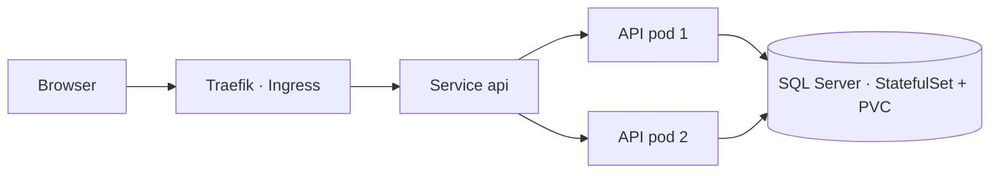
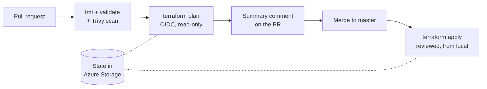

# 💰 FinanceTracker

**English** · [Español](README.es.md)


[](https://github.com/antonicr1986/FinanceTracker/pkgs/container/financetracker)

FinanceTracker is a personal finance tracking API built with .NET 8, Entity Framework Core and SQL Server. It runs on Azure App Service against Azure SQL, and on SQL Server LocalDB or a container for local development.

The goal of this project is to practice and demonstrate backend development skills using a layered architecture, DTOs, services, validation, Entity Framework Core and automated tests.

**Live API:** the deployment is public — try it on
[Swagger](https://financetracker-api-cpctbta0gddddge5.belgiumcentral-01.azurewebsites.net/swagger).
It runs on Azure's free tier: the app unloads after 20 idle minutes and the
serverless database pauses after an hour. A scheduled workflow keeps the app
loaded on weekdays during working hours, and the three clients wake the database
as soon as their sign-in screen opens, so the wait mostly happens while you are
still reading it.

## 🧩 Clients

Three clients consume this API, each from a different platform and language.
Having more than one consumer is what turns the API into a contract: the same
endpoints, the same error codes and the same business rules have to hold from
TypeScript, Kotlin and C# alike. All three share the same look, light and dark
themes, Spanish and English, and the same public demo account, one click away.

| Client | Stack | Try it |
| --- | --- | --- |
| [financetracker-web](https://github.com/antonicr1986/financetracker-web) | Next.js, TypeScript, Tailwind CSS | **[Live on Vercel](https://financetracker-web-tau.vercel.app/login)** |
| [financetracker-android](https://github.com/antonicr1986/financetracker-android) | Kotlin, Retrofit, Material 3 | **[Signed APK](https://github.com/antonicr1986/financetracker-android/releases/latest)** |
| [financetracker-desktop](https://github.com/antonicr1986/financetracker-desktop) | C#, WPF, MVVM | **[Windows download](https://github.com/antonicr1986/financetracker-desktop/releases/latest)** |

The API does not reject repeated category names, so the three clients check it
themselves, all in the same way: same type, ignoring case and surrounding
spaces.

## ✨ Features

- User registration and login with JWT authentication
- All finance endpoints require a valid bearer token
- Manage income and expense categories
- Manage financial transactions
- Manage monthly budgets
- Filter transactions by type, category and date range
- Paginated transaction results
- Calculate financial summary:
  - Total income
  - Total expenses
  - Balance
- Dashboard summary endpoint
- Budget usage calculations:
  - Spent amount
  - Remaining amount
  - Usage percentage
- Basic validation using Data Annotations
- Business rules:
  - Transactions cannot be created with a non-existing category
  - Transactions cannot be created when the category type does not match the transaction type
  - Transactions cannot be updated with a non-existing category
  - Transactions cannot be updated when the category type does not match the transaction type
  - Budgets cannot be created with a non-existing category
  - Budgets cannot be created when the category type does not match the budget type
  - Budgets cannot be updated when the category type does not match the budget type
  - Categories with associated transactions cannot be deleted
- Finance data scoped to the authenticated user
- Starter categories seeded when an account is registered, in the language the
  client sends at sign-up (`"language": "en"` or `"es"`; Spanish when absent)
- A public demo account seeded on startup, for trying the app without signing up
- Error responses as ProblemDetails carrying a language-agnostic `code`
- CORS origins read from configuration, changeable without redeploying
- Retries on transient SQL failures, so a paused serverless database does not
  turn the first request of the day into a 500
- Health check endpoints and structured logging with Serilog
- Global exception handling
- Automated tests with xUnit and EF Core InMemory

## 🛠️ Technologies

- .NET 8
- ASP.NET Core Web API
- Entity Framework Core
- SQL Server (Azure SQL in production, LocalDB or a container locally)
- JWT authentication (bearer tokens)
- xUnit
- EF Core InMemory
- Swagger / OpenAPI
- Git / GitHub
- GitHub Actions (CI/CD)
- Docker / Docker Compose
- GitHub Container Registry (GHCR)
- Terraform (Azure infrastructure, remote state, OIDC)
- Kubernetes / Helm (Deployment, StatefulSet, probes, Ingress with Traefik)

## 🧱 Architecture

The solution follows a layered architecture:

FinanceTracker
├── FinanceTracker.Api
├── FinanceTracker.Application
├── FinanceTracker.Domain
├── FinanceTracker.Infrastructure
└── FinanceTracker.Tests

### 🌐 FinanceTracker.Api

Contains the REST API controllers and application startup configuration.

### 📦 FinanceTracker.Application

Contains DTOs, interfaces and application-level contracts.

### 🧠 FinanceTracker.Domain

Contains the main domain entities and enums.

### 🗄️ FinanceTracker.Infrastructure

Contains Entity Framework Core configuration, database context, migrations and service implementations.

### 🧪 FinanceTracker.Tests

Contains automated tests for the application logic.

## 🔗 Main Endpoints

### 📁 Categories

GET /api/Categories  
GET /api/Categories/{id}  
POST /api/Categories  
PUT /api/Categories/{id}  
DELETE /api/Categories/{id}

### 💳 Transactions

GET /api/Transactions  
GET /api/Transactions/{id}  
POST /api/Transactions  
PUT /api/Transactions/{id}  
DELETE /api/Transactions/{id}

### 💰 Budgets

GET /api/Budgets  
GET /api/Budgets/{id}  
POST /api/Budgets  
PUT /api/Budgets/{id}  
DELETE /api/Budgets/{id}

### 🔎 Transaction Filters

GET /api/Transactions?type=2  
GET /api/Transactions?categoryId=4  
GET /api/Transactions?fromDate=2026-05-01&toDate=2026-05-31

### 📄 Transaction Pagination

GET /api/Transactions?pageNumber=1&pageSize=10

Example response:

{
  "items": [],
  "totalCount": 25,
  "pageNumber": 1,
  "pageSize": 10,
  "totalPages": 3
}

### 📊 Financial Summary

GET /api/Transactions/summary  
GET /api/Transactions/summary?fromDate=2026-05-01&toDate=2026-05-31  
GET /api/Transactions/summary?categoryId=4

Example response:

{
  "totalIncome": 2000,
  "totalExpense": 350,
  "balance": 1650
}

### 📈 Dashboard Summary

GET /api/Dashboard/summary  
GET /api/Dashboard/summary?fromDate=2026-05-01&toDate=2026-05-31  
GET /api/Dashboard/summary?categoryId=4

Example response:

{
  "totalIncome": 2000,
  "totalExpense": 350,
  "balance": 1650,
  "transactionCount": 5,
  "latestTransactions": []
}

### 💼 Budget Usage

GET /api/Budgets

Example response:

{
  "id": 1,
  "name": "Food budget June",
  "amount": 300,
  "spentAmount": 100,
  "remainingAmount": 200,
  "usagePercentage": 33.33,
  "month": 6,
  "year": 2026,
  "type": 2,
  "categoryId": 1,
  "categoryName": "Food"
}

## 📊 Dashboard

The API includes a dashboard summary endpoint that provides an overview of the current financial situation.

GET /api/Dashboard/summary

Example response:

{
  "totalIncome": 2000,
  "totalExpense": 350,
  "balance": 1650,
  "transactionCount": 5,
  "latestTransactions": []
}

## 🚀 Getting Started

### ✅ Prerequisites

- Visual Studio 2022
- .NET 8 SDK
- A SQL Server instance: LocalDB, the compose container, or Azure SQL

### 🔐 Configuration and secrets

`appsettings.json` is versioned and holds configuration only — logging, CORS
origins, JWT issuer and audience. **No secret lives there.** The connection
string and the JWT signing key are supplied from outside:

Locally, with user secrets (the project already has a `UserSecretsId`):

    cd FinanceTracker.Api
    dotnet user-secrets set "ConnectionStrings:DefaultConnection" "<your connection string>"
    dotnet user-secrets set "Jwt:Key" "<a long random string>"

In Azure, the values live in **Key Vault** (`kv-financetracker`). The App
Service environment variables `ConnectionStrings__DefaultConnection` and
`Jwt__Key` hold only a reference, such as
`@Microsoft.KeyVault(VaultName=kv-financetracker;SecretName=Jwt--Key)`, which the
platform resolves at startup with the web app's **managed identity**, so the
code reads them as ordinary configuration. The double underscore is how the
platform spells the `:` of .NET configuration; Key Vault secret names use `--`
instead, because they do not allow underscores.

### 🗃️ Database Setup

Any SQL Server will do: LocalDB, the container from the compose file, or Azure
SQL. Point the connection string at it and apply the migrations.

Apply migrations using the Package Manager Console:

Update-Database

Or using the .NET CLI:

dotnet ef database update

The API applies any pending migrations automatically at startup, so a fresh
SQL Server instance is set up without any manual step. It also seeds the demo
account on first run.

## ▶️ Running the API

Set `FinanceTracker.Api` as the startup project and run the application.

Swagger will be available at:

https://localhost:{port}/swagger

## 🐳 Running with Docker

The project can also run fully containerized (API + SQL Server) using Docker Compose.

### ✅ Prerequisites

- Docker Desktop

### 🔐 Environment variables

Create a `.env` file in the root of the project (it is git-ignored and never committed) with:

MSSQL_SA_PASSWORD=YourStrongPassword123!
JWT_KEY=your-generated-jwt-key

### ▶️ Run

docker compose up --build

This starts two containers:

- `api` — the FinanceTracker API, available at `http://localhost:8080`
- `db` — SQL Server 2022, available on port `1433`

Swagger will be available at:

http://localhost:8080/swagger

## 📦 Running from the published image

Every push to `master` publishes a container image to GitHub Container Registry, so the
application can be run without cloning the repository or building anything.

docker pull ghcr.io/antonicr1986/financetracker:latest

`docker-compose.prod.yml` starts the published image alongside SQL Server:

docker compose -f docker-compose.prod.yml up -d

Unlike the development compose file, this one:

- Pulls the image instead of building from source
- Keeps the database in a named volume, so data survives a restart
- Waits for a SQL Server health check before starting the API
- Does not expose port 1433 to the host

To deploy a specific commit rather than the latest build:

IMAGE_TAG=sha-<commit-sha> docker compose -f docker-compose.prod.yml up -d

## ☸️ Kubernetes (Helm)

The same image the pipeline publishes to GHCR can also run on any Kubernetes cluster, packaged as a Helm chart in [`charts/financetracker`](charts/financetracker). It has been tested on a local cluster (Docker Desktop); production keeps running on Azure App Service.



- **API as a Deployment** with 2 replicas and zero-downtime rolling updates (`maxUnavailable: 0`).
- **Three probes**: startup (gives the migrations time), liveness on `/health` (restarts a hung process) and readiness on `/health/ready` (takes a pod out of traffic if it cannot reach the database, without restarting it).
- **An initContainer** waits for SQL Server before the API starts, so it never tries to migrate against a database that is not ready.
- **SQL Server as a StatefulSet** with a persistent volume: the data survives deleting the pod and even redeploying it from scratch.
- **Secrets stay out of Git**: the chart only references Secrets that already exist in the cluster.
- **Ingress with Traefik**: the API is reached by domain, load-balanced across the ready replicas.
- `sql.enabled: false` deploys only the API, pointing to an external database such as Azure SQL.

### ▶️ Deploy

Prerequisites: a cluster (`kubectl get nodes` → Ready), Helm and an Ingress controller (Traefik):

```bash
helm repo add traefik https://traefik.github.io/charts
helm install traefik traefik/traefik -n traefik --create-namespace
```

Create the namespace and the Secrets (never committed):

```bash
kubectl create namespace financetracker
kubectl create secret generic sql-secret -n financetracker \
  --from-literal=MSSQL_SA_PASSWORD='<strong-password>'
kubectl create secret generic api-secret -n financetracker \
  --from-literal=ConnectionStrings__DefaultConnection='Server=sql;Database=FinanceTrackerDb;User Id=sa;Password=<strong-password>;TrustServerCertificate=True' \
  --from-literal=Jwt__Key="$(openssl rand -base64 48)"
```

Install the chart:

```bash
helm install financetracker charts/financetracker -n financetracker
```

Then open `http://financetracker.localhost/health/ready` and `http://financetracker.localhost/swagger`.

Any value can be changed without touching the templates, and every change can be rolled back:

```bash
helm upgrade financetracker charts/financetracker -n financetracker --set api.replicas=3
helm rollback financetracker 1 -n financetracker
```

## ⚙️ CI/CD

This project uses GitHub Actions. On every push and pull request to `master`, the
pipeline automatically:

- Restores the solution and checks its formatting with `dotnet format`
  against `.editorconfig` (lint)
- Fails if any NuGet package, direct or transitive, has a known vulnerability
- Builds the solution
- Runs the automated test suite
- Builds the Docker image and scans it with Trivy

It also scans the **full repository history** for leaked credentials with
gitleaks, as a job that does not depend on the build: if something leaked, it
does not matter whether the code compiles.

The Docker image is scanned with **Trivy** before it is published. Unlike the
NuGet package check, Trivy inspects the whole image, base OS libraries included.
It fails on any high or critical vulnerability that already has a fix; those
without one are shown in the log but do not block, because there is nothing to
update and a pipeline that is always red stops being read.

On pushes to `master` it additionally:

- Publishes the image to GitHub Container Registry
- Tags it with the full commit SHA and with `latest`
- Deploys that very same image to Azure App Service, by its SHA tag: production
  runs exactly what was scanned, with no rebuild. It only happens once **every**
  check passes: tests, image scan, secret scan, infrastructure validation and
  security scan, and the active DAST of the API (see below). If any of them
  fails, nothing is deployed
- After the deployment, **OWASP ZAP** reviews the published API (passive DAST,
  baseline mode) and the pipeline fails if a new alert shows up

**Active DAST of the API (`dast-api` job).** On every push and pull request,
the workflow starts a **throwaway** API and SQL Server on the runner with
`docker compose` and random keys, signs in with the demo account and runs the
**OWASP ZAP** API scan from `swagger.json`: it attacks every endpoint,
including the ones that require a JWT, with injections, malformed input and
unauthorised requests. These are real attacks, which is why they never target
production. If ZAP finds anything new, the job fails and **nothing is
deployed**. Expected findings (such as validation 400s) are listed in
`.zap/rules.tsv` as informational, each with its reason: they still appear in
the report but do not block. The reports are kept as run artifacts
(`zap-report` and `zap-api-report`) rather than issues, because the
repository is public.

**Security headers.** Every response carries HSTS, `X-Content-Type-Options`,
`X-Frame-Options` and `Referrer-Policy`; API responses also get a
`default-src 'none'` CSP, `Cache-Control: no-store` and
`Cross-Origin-Resource-Policy` (see `Middleware/SecurityHeaders.cs`). HSTS is
added by hand because TLS is terminated by Azure and requests reach the
container over plain HTTP.

Pull requests build the image to validate the Dockerfile, but never publish. Because
every build is tagged by commit SHA, any previous version can be redeployed as-is,
with no rebuild: locally with `IMAGE_TAG` in the production compose file, and in
Azure by changing the container's tag.

The workflow itself is kept tight: the `GITHUB_TOKEN` is read-only by default
and only the jobs that need more ask for it; every job has a time limit, so a
stuck one does not burn minutes for hours; and only one production deployment
runs at a time (`concurrency`), without cancelling the one in progress.

Dependabot opens a monthly pull request with the minor and patch updates of the
NuGet packages and the workflow actions, grouped in one; major versions are left
for a manual decision.

A second workflow, `keep-warm.yml`, calls `/health` every 15 minutes on
weekdays during working hours so the free-tier app stays loaded. It hits the
liveness check on purpose, which does not touch the database: Azure SQL keeps
pausing when nobody uses it and does not burn the free vCore quota. If the API
does not answer after several attempts the run fails, which doubles as a
production alert.

Workflow files: `.github/workflows/ci.yml` and `.github/workflows/keep-warm.yml`

## 🔷 Azure DevOps

Besides GitHub Actions, the four repositories of the project — this API and the
three clients — also live in **Azure DevOps**, grouped in one project: Azure
Repos holds a copy of each one, and Azure Pipelines builds and tests them from
there. The goal is running the same CI on both platforms, not replacing one with
the other.

**How it flows:** push to GitHub → copy in Azure Repos → Azure Pipeline. A
workflow in each repository (`sync-azure-devops.yml` here, `mirror-azure.yml` in
the clients) pushes every branch and tag to Azure Repos with a personal access
token kept as a GitHub secret. Azure Pipelines listens to that copy, so nothing
has to be pushed twice.

The API pipeline, `azure-pipelines.yml`, runs in two stages:

- **Build and tests**: restore, build in Release, run the xUnit suite with code
  coverage, publish the results to the run's *Tests* and *Code Coverage* tabs,
  and keep the published API as a pipeline artifact.
- **Docker**: build the image, only once the first stage is green, to validate
  the Dockerfile.

Each client has its own pipeline: lint, tests and production build for the web;
format check, build and tests on Windows for the desktop; unit tests and a debug
APK for Android.

Three decisions behind it:

- **The copy does not depend on the CI.** The sync is a job of its own, so Azure
  Repos stays identical to GitHub even when a build fails: a red build is still
  a commit that happened.
- **Deploying stays in GitHub Actions.** Azure Pipelines only validates. Two
  systems deploying the same push would race each other, the same problem the
  web client had with Vercel.
- **The Azure DevOps project is private.** Microsoft has retired public projects
  in Azure DevOps, so it cannot be opened without an invitation; this section
  and the pipeline files are how it shows from here.

## 🏗️ Infrastructure as Code (Terraform)

The Azure infrastructure is described with **Terraform** in [`terraform/`](terraform/):
resource group, App Service plan (F1), Linux web app (container from GHCR),
Azure SQL server and serverless database, Key Vault and monitoring. The original
resources already existed and were **imported** with `import` blocks, without
recreating anything.



- **Remote state** in Azure Storage: encrypted, locked during each operation
  (blob lease) and versioned. The storage account only accepts Entra ID
  identities; account keys are disabled.
- **`terraform plan` on every pull request.** GitHub Actions signs in to Azure
  with **OIDC** (no secrets stored in GitHub), using an identity with a custom
  read-only role scoped to the resource group. It posts a summary on the PR
  (resource and action) and warns if anything would be destroyed or replaced.
- **No secrets in public logs.** The repository is public and a full plan would
  print the app settings, so only the summary is published.
- **Secrets stay out of Terraform.** App settings (connection string, JWT key)
  are ignored with `ignore_changes`; the SQL admin password is a **write-only**
  argument fed from an ephemeral variable, so it never lands in the state or in
  the plan. Rotating it is a matter of bumping `sql_admin_password_version`.
- **Guard rails:** `prevent_destroy` on the resource group, the SQL server and
  the database.
- **Security scanning** with Trivy (`trivy config`) on every push and pull
  request: it looks for misconfigurations (public access, TLS, encryption...)
  and fails on high or critical findings, which also blocks the deployment.
  Exceptions are deliberate decisions, such as what the free tier does not
  allow, and are documented with their reason in `terraform/.trivyignore`.
- **Secrets in Key Vault, read through a managed identity.** The connection
  string and the JWT key live in Key Vault (RBAC authorization, soft delete and
  purge protection), and the web app's managed identity has the **Key Vault
  Secrets User** role on that vault only: it can read secrets and nothing else.
  Terraform creates the vault and the role assignments, but **not the secret
  values**, which are loaded once with the CLI so they never reach the state.
  Public network access is a documented exception (`AZU-0013`): the F1 plan has
  no VNet integration, and access is still gated by Entra ID roles.
- **Clear split with the pipeline:** Terraform owns the infrastructure; the
  `deploy` job owns the container image (ignored by Terraform), so they never
  fight over the same setting.

## 📈 Observability (Azure Monitor)

The API sends its telemetry to **Application Insights** with **OpenTelemetry**
(`Azure.Monitor.OpenTelemetry.AspNetCore`): every request with its endpoint,
status code and duration, outgoing calls, exceptions and the Serilog logs. It
is only enabled when `APPLICATIONINSIGHTS_CONNECTION_STRING` exists, so
nothing is sent locally, in tests or in the throwaway DAST environment.

Everything is in Terraform ([`terraform/monitoring.tf`](terraform/monitoring.tf)):

- **Log Analytics Workspace** with 30-day retention and a **daily ingestion
  cap**, so it never leaves the free tier.
- **Application Insights** on top of that workspace.
- **Email alerts** on the Web App metrics: more than 5 **5xx** errors in 5
  minutes, and **spikes of 401s and 403s**, the typical footprint of a brute
  force attack on the login or someone probing where they should not be.

## 🧪 Running Tests

Tests can be executed from Visual Studio Test Explorer or with:

dotnet test

Current automated tests: 74 passing tests.

Test coverage currently includes:

- Category service logic
- Transaction service logic
- Dashboard service logic
- Budget service logic
- Filtering
- Transaction update and delete scenarios
- Transaction filtering by category and date range
- Not found scenarios for budgets and transactions

## 🤖 AI-assisted development

The project is developed with AI that splits, proposes and writes code in small steps, while decisions stay human. Instructions for agents live in [`CLAUDE.md`](CLAUDE.md) ([`AGENTS.md`](AGENTS.md) for other tools).

```
/backlog  →  /story  →  /pair  →  /code-review
```

| Skill | What it does |
| --- | --- |
| [`/backlog`](.claude/skills/backlog/SKILL.md) | Turns an idea into a short backlog of vertical user stories. |
| [`/story`](.claude/skills/story/SKILL.md) | Refines one story: 2–3 acceptance criteria and a mini plan. |
| [`/pair`](.claude/skills/pair/SKILL.md) | Implements the story with TDD, one test at a time, waiting for approval. |
| [`/code-review`](.claude/skills/code-review/SKILL.md) | Reviews the changes against the story before the commit. |

## 📌 Project Status

Implemented:

- Layered solution structure
- Entity Framework Core setup
- Database migrations, applied automatically at startup
- Category CRUD
- Transaction CRUD
- Budget CRUD
- Dashboard summary endpoint
- Transaction filters
- Paginated transaction results
- Financial summary endpoint
- Budget usage calculations:
  - Spent amount
  - Remaining amount
  - Usage percentage
- DTO validation with Data Annotations
- Business rules:
  - Transactions cannot be created with a non-existing category
  - Transactions cannot be updated with a non-existing category
  - Transactions must match the selected category type
  - Budgets cannot be created with a non-existing category
  - Budgets must match the selected category type
  - Categories with associated transactions cannot be deleted
- Swagger / OpenAPI testing
- Automated tests with xUnit and EF Core InMemory
- JWT authentication (register and login)
- Migrations applied automatically on startup
- Dockerized application (API + SQL Server via Docker Compose)
- CI/CD pipeline with GitHub Actions (build, test, publish)
- Container image published to GHCR, tagged by commit SHA
- Production compose file with health checks and a persistent database volume
- User-scoped finance data
- Starter categories seeded on registration in the sign-up language, and a seeded public demo account
- Global exception handling
- Health check endpoints (`/health` liveness, `/health/ready` readiness)
- Structured logging with Serilog
- Secret scanning over the full history with gitleaks in the pipeline
- Deployed to Azure App Service, published automatically from the pipeline
- Error responses as ProblemDetails with a language-agnostic `code`
- Resilience against transient SQL failures (paused serverless database)

Planned improvements:

- More advanced budget reports
- Controller tests
- Localised validation messages (the ones ASP.NET generates are still English)
- Dependency vulnerability scanning in the pipeline
- Kubernetes deployment

## 🎯 Purpose

This project is part of my portfolio as a .NET developer.

It is intended to demonstrate clean project structure, backend API development, Entity Framework Core usage, validation, testing and GitHub workflows.
